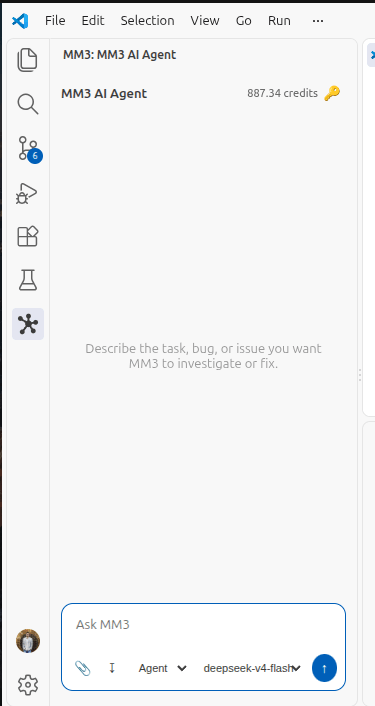

# MM3 AI Agent for VS Code

MM3 is an AI coding workspace for investigating, understanding, and safely improving your code from inside VS Code.

The VS Code extension builds local project intelligence and enforces safety. The MM3 backend handles AI reasoning, specialist agents, model routing, accounts, and credits. File access stays under the extension's control.

## What You Can Do

- Ask questions about your project, files, or selected code.
- Investigate bugs, architecture, dependencies, and implementation tasks.
- Use Ask mode for answers based on the context you provide.
- Use Agent mode for adaptive read-only investigation and grounded coding plans.
- Attach files or the current editor selection to a question.
- View citations, quoted code, validation checks, confidence, and proposed diffs.
- Review, accept, reject, or roll back approved file changes.
- Choose specialist agents for exploration, bugs, reviews, architecture, implementation, testing, or project memory.
- Use AI models from supported providers such as OpenAI, Claude, Gemini, Grok, and DeepSeek.
## Preview

## Safety And Privacy

- The backend does not receive direct filesystem or terminal access.
- File reads and investigation tools run locally through validated extension APIs.
- Ask mode cannot investigate, run tools, or modify files.
- Agent mode can propose changes, but changes require your explicit approval.
- Workspace boundaries and sensitive-path checks are applied before local access.
- The extension sends only the context and evidence needed for the request.

## Getting Started

1. Install MM3 AI Agent from the VS Code Marketplace.
2. Open a workspace in VS Code.
3. Open **MM3: Open Chat** from the Command Palette or the MM3 activity-bar view.
4. Create or sign in to your account at [www.mm3ai.com](https://www.mm3ai.com), then provide your MM3 access token when prompted.
5. Choose **Ask** or **Agent**, select an available agent, and send your question.

Use the paperclip button to attach files. You can also use **MM3: Add Selection to Chat** from the editor context menu.

AI requests use MM3 credits. Plans and available models are managed through your MM3 account.

## Review Changes

When Agent mode proposes file changes, MM3 shows a review panel with the affected files and diffs. Review each file before accepting it. You can reject individual files, accept all reviewed files, or use **MM3: Roll Back Last Approved Changes**.

## Configuration

Open **Settings** and search for `MM3`.

| Setting | Description | Default |
| --- | --- | --- |
| `mm3.maxContextChars` | Maximum source context sent to the backend | `5000000` |
| `mm3.maxFilesInContext` | Maximum files included in a request | `1000` |
| `mm3.enableAutoIndex` | Build the workspace index automatically | `true` |

The default URL is for local backend development. Hosted users should use the MM3 backend endpoint provided with their account.

## Commands

- **MM3: Open Chat**
- **MM3: Add Selection to Chat**
- **MM3: Scan Project**
- **MM3: Rebuild Project Index**
- **MM3: Clear Conversation**
- **MM3: Roll Back Last Approved Changes**
- **MM3: Reset Access Token**

## Requirements

- VS Code `1.90` or newer.
- An MM3 account, access token, and available credits.
- Network access to the configured MM3 backend API endpoint.

## Support

Visit [www.mm3ai.com](https://www.mm3ai.com) or email [support@mm3ai.com](mailto:support@mm3ai.com).
